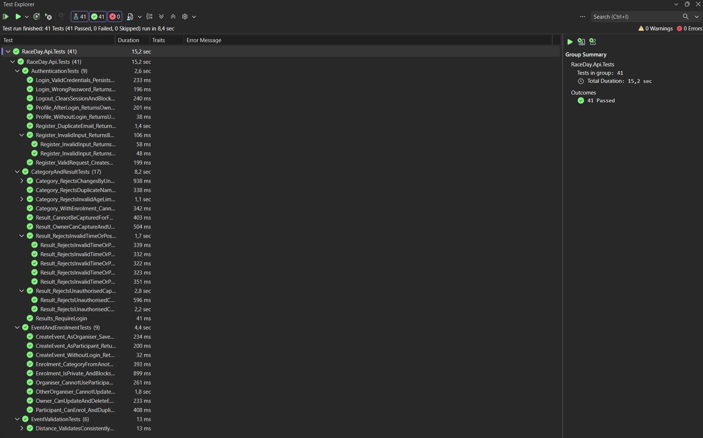
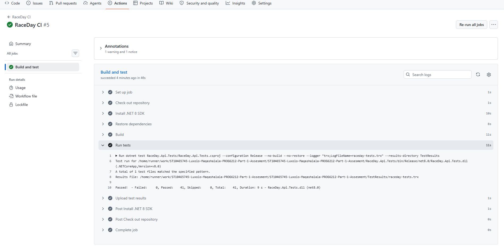

# RaceDay Event Management System

**Student:** Luxolo Maqashalala  
**Student Number:** ST10465745  
**Module:** PROG6212  
**Assessment:** Portfolio of Evidence — Parts 1 and 2

## Project Overview

RaceDay is an event management system for South African road running,
walking and cycling events.

Part 1 covers system planning, database design and API endpoint planning.
Part 2 implements the ASP.NET Core API, database integration,
session-based access control and automated tests.

The API supports Organisers and Participants. Swagger UI provides an
interface for exploring and testing the endpoints during development.

## Implementation Notes

The API project is named `RaceDay`, corresponding to the
`RaceDay.Api` project described in the student guide.

Profile endpoints use `/api/users/me`, consistent with the
Part 1 endpoint plan. The implemented routes are documented
in the API Routes section and Swagger.

## Presentation

- [Part 1 demonstration video](https://youtu.be/r2tRXuNNo2U)
- [Part 2 demonstration video](https://youtu.be/fj8GOFvHJZk)

## Technologies

- C# and .NET 8
- ASP.NET Core Web API
- Entity Framework Core 8
- SQL Server LocalDB
- Swagger / Swashbuckle
- xUnit
- ASP.NET Core WebApplicationFactory
- EF Core InMemory provider for automated tests
- GitHub Actions
- Visual Studio 2022

## Project Structure

| Location | Purpose |
|---|---|
| `RaceDay/` | API, controllers, models, database context and migrations |
| `RaceDay.Contracts/` | Request and response DTOs |
| `RaceDay.Api.Tests/` | Automated tests and test application factory |
| `docs/` | Part 1 design documents and database script |
| `docs/images/` | Screenshots demonstrating testing and automation |
| `.github/workflows/` | GitHub Actions workflow configuration |
| `README.md` | Project overview and setup instructions |

## User Roles and Features

### Organiser

- Register, log in and log out.
- View and update their own profile.
- Create and manage their own events.
- Create and manage categories for their events.
- View enrolments for their events.
- Capture and update participant finish times and positions.
- View results for their events.

Ownership checks prevent organisers from changing another organiser's
events, categories or results.

### Participant

- Register, log in and log out.
- View and update their own profile.
- Browse events and categories.
- Enrol in an event and select a category.
- View their own enrolments.
- Withdraw their own enrolment.
- View their own results.

## Database Design

The database contains six application entities:

| Entity | Purpose |
|---|---|
| Role | Defines Organiser and Participant roles |
| User | Stores account details, password hashes and role membership |
| Event | Stores event information and its organiser |
| Category | Stores event categories and optional age limits |
| Enrolment | Links a participant to an event and category |
| Result | Stores an enrolment's finish time and finishing position |

The design includes primary keys, foreign keys, unique constraints,
check constraints and relationships.

The initial EF Core migration seeds:

| Role ID | Role |
|---|---|
| 1 | Organiser |
| 2 | Participant |

### Part 1 Documents

- [Entity Relationship Diagram](docs/RaceDay_ERD.md)
- [API Endpoint Plan](docs/RaceDay_API_Endpoint_Plan.md)
- [SQL Database Script](docs/RaceDay_Database.sql)

The Part 1 SQL script creates the planning database, `RaceDayDB`.

The Part 2 application uses EF Core migrations to create and update
`RaceDayPart2Db`. Use the migration instructions below when setting up
the application database.

## Running the Application

### Requirements

- Windows with Visual Studio 2022
- ASP.NET and web development workload
- .NET 8 SDK
- SQL Server Express LocalDB
- SQL Server Management Studio, optionally, for inspecting data

### 1. Open the Project

Clone or download this repository and open the solution in Visual Studio.

Set `RaceDay` as the startup project.

### 2. Configure the Database Connection

In `RaceDay/appsettings.json`, ensure the following connection string
exists alongside the existing logging and application settings:

```json
"ConnectionStrings": {
  "DefaultConnection": "Server=(localdb)\\MSSQLLocalDB;Database=RaceDayPart2Db;Trusted_Connection=True;TrustServerCertificate=True;"
}
```

This is a section to include inside the existing JSON object, not a
replacement for the entire file.

### 3. Apply the Existing Migrations

Open Visual Studio's Package Manager Console and run:

```powershell
Update-Database -Project RaceDay -StartupProject RaceDay -Context RaceDayDbContext
```

This creates the application database, applies the committed migrations
and inserts the seeded roles.

You do not need to create another initial migration.

### 4. Start the API

Select the HTTPS launch profile and start the `RaceDay` project.

Open `/swagger` at the application's HTTPS address.

Example for the development port used in this project:

```text
https://localhost:7259/swagger
```

Check `RaceDay/Properties/launchSettings.json` for the configured port.
Swagger is enabled in the Development environment.

## Trying the API in Swagger

1. Register an Organiser using `roleId: 1`.
2. Log in with that account.
3. Create an event and a category.
4. Log out.
5. Register and log in as a Participant using `roleId: 2`.
6. Enrol in the event using its category ID.
7. View the participant's enrolments.
8. Log out and log in as the event's Organiser.
9. Capture a result for the enrolment.
10. Log in as the Participant and view their results.

Use an event dated today or earlier when demonstrating result capture.
The API rejects results for future events.

Authentication uses a session cookie. Use the same browser session for
login and subsequent protected requests.

## Main API Routes

| Area | Example routes |
|---|---|
| Authentication | `POST /api/auth/register`, `POST /api/auth/login`, `POST /api/auth/logout` |
| Session | `GET /api/auth/session` |
| Profile | `GET /api/users/me`, `PUT /api/users/me` |
| Events | `GET /api/events`, `POST /api/events`, `GET /api/events/mine` |
| Event management | `GET`, `PUT`, `DELETE /api/events/{id}` |
| Categories | `GET`, `POST /api/events/{eventId}/categories` |
| Category management | `GET`, `PUT`, `DELETE /api/categories/{id}` |
| Enrolment | `POST /api/events/{eventId}/enrolments` |
| Participant enrolments | `GET /api/enrolments/me` |
| Organiser enrolment view | `GET /api/events/{eventId}/enrolments` |
| Withdrawal | `DELETE /api/enrolments/{id}` |
| Result capture | `POST /api/enrolments/{enrolmentId}/result` |
| Result update | `PUT /api/results/{id}` |
| Participant results | `GET /api/results/me` |
| Organiser results view | `GET /api/events/{eventId}/results` |

Swagger documents the request schemas and available responses.

## Validation and Access Control

The API includes:

- Password hashing.
- Duplicate-email checks.
- Session-based login and logout.
- Role and ownership checks for protected operations.
- Event distance and event-type validation.
- Category age-range validation.
- Duplicate category-name checks within an event.
- Category-to-event matching during enrolment.
- Duplicate enrolment prevention.
- Restrictions on deleting events or categories with enrolments.
- Finish-time and finishing-position validation.
- Duplicate result prevention.
- Rejection of result capture for future events.
- Participant access limited to their own enrolments and results.

Category age limits are validated for consistency. Participant age
eligibility is not currently enforced because the user model does not
store a date of birth.

## Automated Testing

The recorded local test run completed with:

**41 passed — 0 failed — 0 skipped.**

| Test class | Cases | Coverage |
|---|---:|---|
| `AuthenticationTests` | 9 | Registration, login, sessions, profiles and logout |
| `EventAndEnrolmentTests` | 9 | Event ownership, enrolment rules and privacy |
| `EventValidationTests` | 6 | Decimal validation under different cultures |
| `CategoryAndResultTests` | 17 | Category restrictions, result validation and access |
| **Total** | **41** | |

### Run in Visual Studio

Open **Test → Test Explorer → Run All Tests**.

### Run from the Repository Root

```bash
dotnet test RaceDay.Api.Tests/RaceDay.Api.Tests.csproj --configuration Release
```

The tests use a test application host and an isolated EF Core InMemory
database. They do not require the application's LocalDB database.

The InMemory provider does not reproduce all SQL Server behaviours.
These tests verify API behaviour; they do not replace SQL Server
integration testing of relational constraints and migrations.

### Test Evidence



## Continuous Integration

The GitHub Actions workflow is intended to:

1. Check out the repository.
2. Install the .NET 8 SDK.
3. Restore dependencies.
4. Build the test project and its referenced projects.
5. Run the automated test suite.
6. Upload a test-results artifact.

The workflow is configured for pushes, pull requests and manual runs.

Open the repository's **Actions** tab and inspect the latest run's build
and test steps to review the outcome.

### Workflow Evidence



## Version Control

Source code, migrations, documentation and workflow configuration are
stored in Git.

Generated files and local build outputs are excluded through `.gitignore`,
including:

- `bin/`
- `obj/`
- `.vs/`
- `TestResults/`

## Author

Luxolo Maqashalala  
ST10465745  
PROG6212 Part 2
